# On the Shelf

Books we own, plus library loans we have read (kept even after return).

Daily log lives in [read.md](read.md). Covers are in [`covers/`](covers/).

Reader: Mitch (Dad) · also Amy  
Started: August 27, 2026

---

## Home copies

### 1. The Night Before Kindergarten

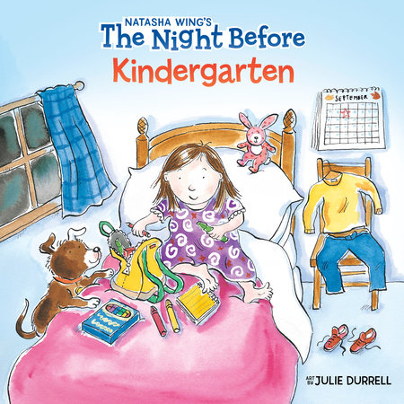

- **Author:** Natasha Wing · **Illustrated by:** Julie Durrell
- **ISBN:** `978-0-448-42500-9`
- **How we read it:** swapped “kindergarten” for “2nd grade”
- **Read:** Tuesday, August 25, 2026 · Mitch

---

### 2. Cowboy Car

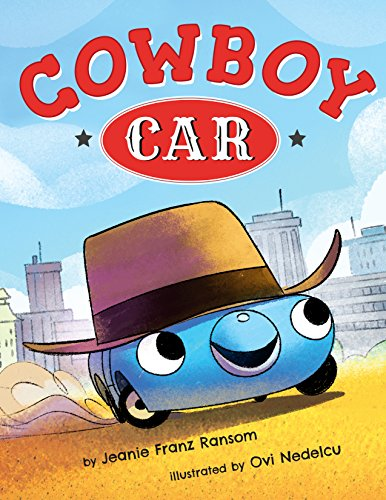

- **Author:** Jeanie Franz Ransom · **Illustrated by:** Ovi Nedelcu
- **Read:** Tuesday, August 25, 2026 · Mitch

---

### 3. Except Antarctica!


- **Author / illustrator:** Todd Sturgell
- **Read:** Tuesday, August 25, 2026 · Mitch

---

### 4. Garfield’s Scary Tales


- **Author:** Jim Kraft · **Illustrated by:** Mike Fentz
- **Favorites:** *Terminal Terror* and *A Ghost’s Story*
- **Read:** Monday, August 24, 2026 · Mitch

---

### 5. My, Oh My—A Butterfly!

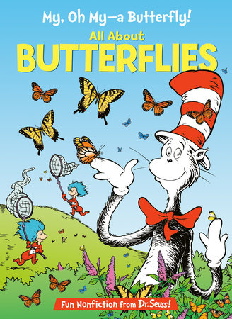

- **Series:** The Cat in the Hat’s Learning Library · Tish Rabe
- **Read:** Tuesday, August 25, 2026 · Mitch

---

### 6. Hooked on Phonics / *Whacky Jack!*

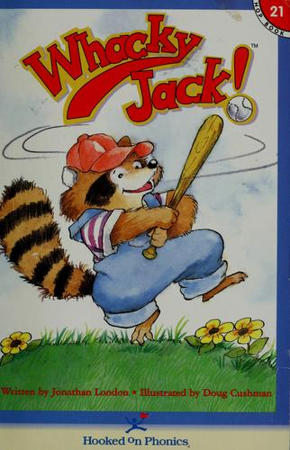

- **Story:** Jonathan London · Doug Cushman · Jack the raccoon learns baseball
- **Note:** pink phonics cover and *Whacky Jack!* are two sides of the same book
- **Read:** Thursday, August 27, 2026 · Mitch

---

### 7. On Beyond Bugs!

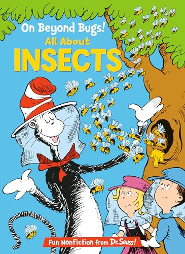

- **Series:** The Cat in the Hat’s Learning Library · Tish Rabe
- **Read:** Thursday, August 27, 2026 · Mitch

---

### 8. Don’t Close Your Eyes

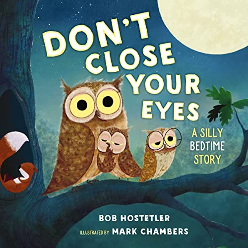

- **Author:** Bob Hostetler · **Illustrated by:** Mark Chambers
- **Read:** Thursday, August 27, 2026 · Mitch

---

### 9. There Was an Old Lady Who Swallowed a Fly

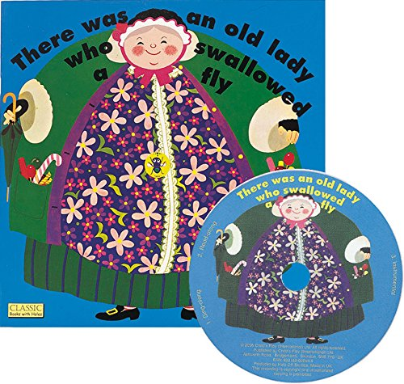

- **Illustrated by:** Pam Adams · Child’s Play die-cut edition
- **Read:** Thursday, August 27, 2026 · Mitch

---

### 10. Swap!

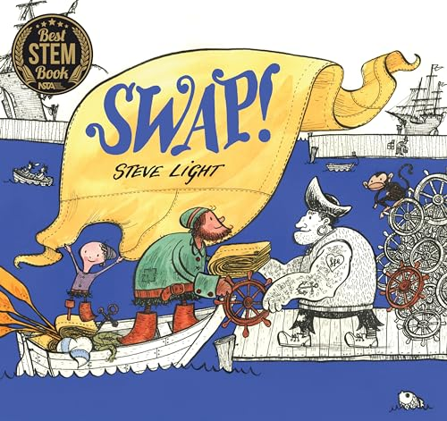

- **Author / illustrator:** Steve Light
- **Favorite:** Saturday, August 29, 2026
- **Read:** Saturday, August 29, 2026 · Mitch

---

### 11. It’s the Great Pumpkin, Charlie Brown

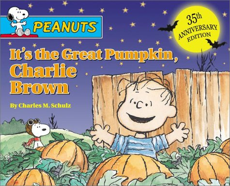

- **By:** Charles M. Schulz
- **Read:** Saturday, August 29, 2026 · Mitch

---

### 12. The Hat

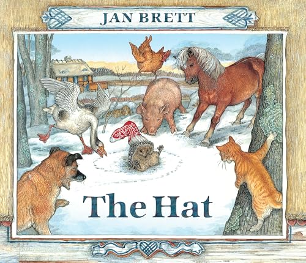

- **Author / illustrator:** Jan Brett
- **Read:** Saturday, August 29, 2026 · Mitch

---

### 13. Oh, the Things They Invented!

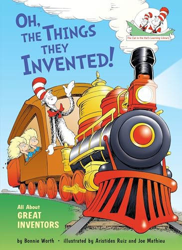

- **Series:** The Cat in the Hat’s Learning Library · Bonnie Worth
- **Read:** Saturday, August 29, 2026 · Mitch

---

### 14. The Remember Balloons

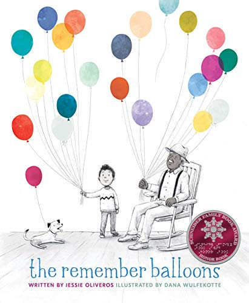

- **Author:** Jessie Oliveros · **Illustrated by:** Dana Wulfekotte
- **ISBN:** `978-1-4814-8915-7`
- **Read:** Sunday, August 30, 2026 · Mitch

---

### 15. Frog Song

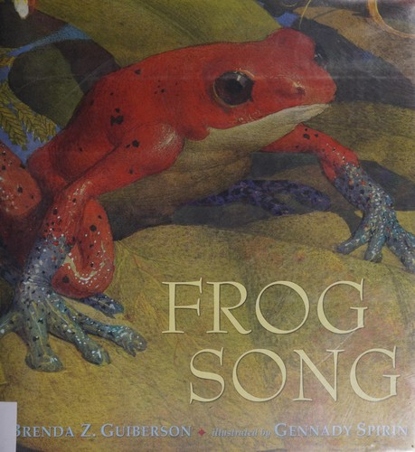

- **Author:** Brenda Z. Guiberson · **Illustrated by:** Gennady Spirin
- **ISBN:** `978-0-8050-9254-7`
- **Read:** Sunday, August 30, 2026 · Mitch

---

### 16. The Party

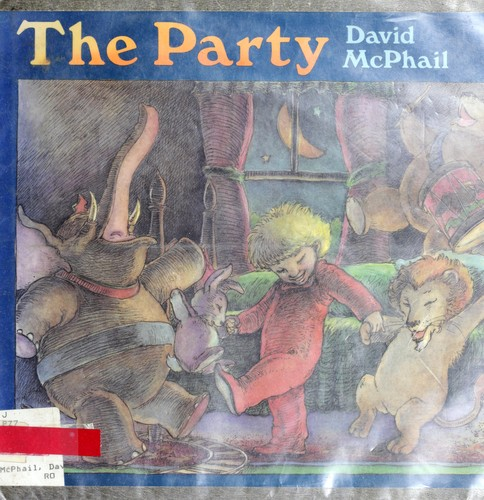

- **Author / illustrator:** David McPhail
- **Favorite:** Sunday, August 30, 2026
- **Read:** Sunday, August 30, 2026 · Mitch

---

### 17. The Secret of Saying Thanks


- **Author:** Douglas Wood · **Illustrated by:** Greg Shed
- **ISBN:** `978-0-689-85410-1`
- **Read:** Monday, August 31, 2026 · Mitch

---

### 18. Make Way for McCloskey: A Robert McCloskey Treasury

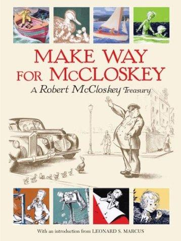

- **Author / illustrator:** Robert McCloskey · intro Leonard S. Marcus
- **ISBN:** `978-0-670-05934-8`
- **Read so far:**
  - *Make Way for Ducklings* and *Blueberries for Sal* — Monday, August 31, 2026 · Mitch (favorite that night: *Make Way for Ducklings*)
  - *Burt Dow, Deep-Water Man* — Thursday, September 3, 2026 · Mitch
  - *Homer Price* (the donut-machine story) — Sunday, September 13, 2026 · Mitch
  - *Lentil* — Thursday, September 17, 2026 · Mitch
- **Still to read:** *Time of Wonder*; *One Morning in Maine*; *Centerburg Tales*

---

### 19. Clam-I-Am!

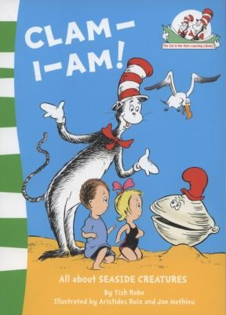

- **Series:** The Cat in the Hat’s Learning Library · Tish Rabe
- **ISBN (this copy):** `978-0-00-728485-6`
- **Read:** Monday, August 31, 2026 · Mitch

---

### 20. Miles and Miles of Reptiles

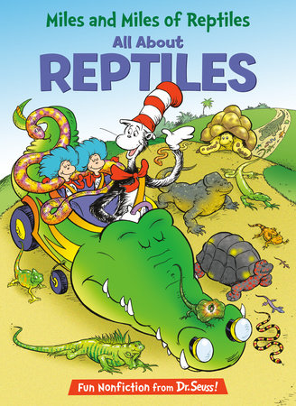

- **Series:** The Cat in the Hat’s Learning Library · Tish Rabe
- **ISBN (this copy):** `978-0-00-746036-6`
- **Read:** Tuesday, September 1, 2026 · Mitch

---

### 21. I’m the Best Artist in the Ocean!

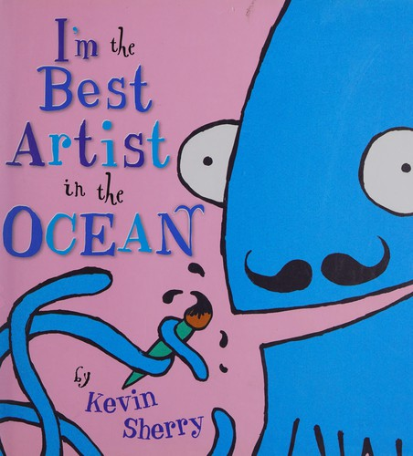

- **Author / illustrator:** Kevin Sherry
- **ISBN:** `978-0-8037-3255-1`
- **Read:** Thursday, September 3, 2026 · Mitch

---

### 22. Are We There Yet?

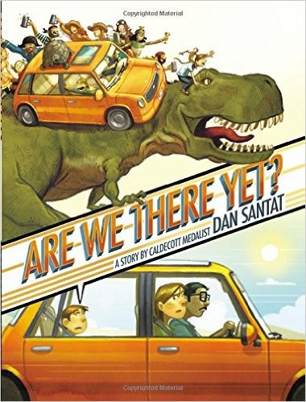

- **Author / illustrator:** Dan Santat
- **Publisher:** Little, Brown
- **ISBN:** `978-0-316-19999-5`
- **Read:** Sunday, September 13, 2026 · Mitch

---

### 23. Night Is Right for Me

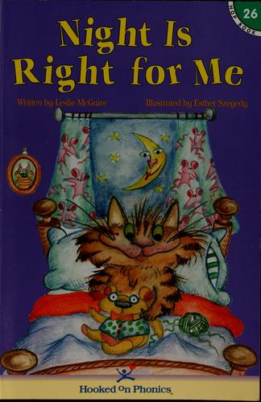

- **Author:** Leslie McGuire · **Illustrated by:** Esther Szegedy
- **Series:** Hooked on Phonics Learn to Read, Book 26
- **ISBN:** `978-1-887942-47-8`
- **Read:** Sunday, September 13, 2026 · Mitch

---

### 24. Snow

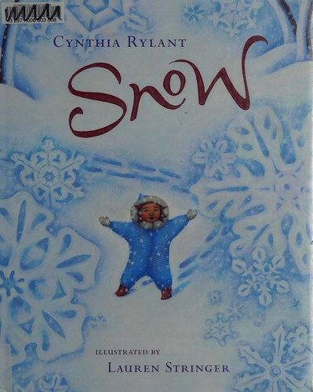

- **Author:** Cynthia Rylant · **Illustrated by:** Lauren Stringer
- **Publisher:** Harcourt / Houghton Mifflin Harcourt (2008)
- **ISBN:** `978-0-15-205303-1`
- **Read:** Sunday, September 20, 2026 · Mitch · only book before he fell asleep

---

### 25. Fishing with Gubby

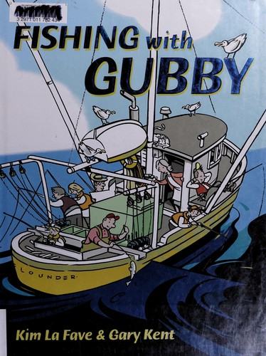

- **Story:** Gary Kent · **Illustrated by:** Kim La Fave
- **Publisher:** Harbour Publishing (2010)
- **ISBN:** `978-1-55017-497-7`
- **Read:** Tuesday, September 29, 2026 · Mitch

---

### 26. Creepy Pair of Underwear!

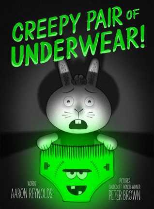

- **Words:** Aaron Reynolds · **Pictures:** Peter Brown
- **Publisher:** Simon & Schuster (2017)
- **ISBN:** `978-1-4424-0298-0`
- **Read:** Tuesday, September 29, 2026 · Mitch

---

### 27. Disney Discovery Series Presents *Manners*

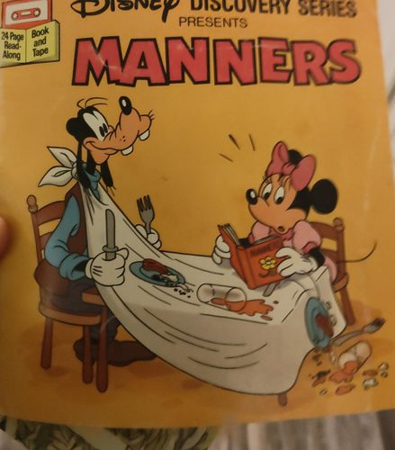

- **Series:** Disney Discovery Series · 24-page read-along book and tape
- **Characters:** Goofy and Minnie at the table
- **Publisher:** Walt Disney Productions / Disneyland Records (mid-1980s)
- **On our bookshelf:** home copy
- **Read:** Wednesday, September 30, 2026 · Mitch

---

### 28. Frog and Toad Are Friends

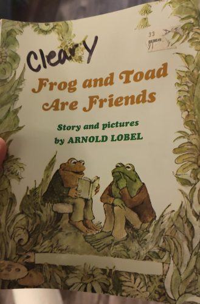

- **Story and pictures:** Arnold Lobel
- **Publisher:** Harper / I Can Read (Level 2)
- **ISBN (this edition):** `978-0-06-444020-2`
- **About:** Five short stories — spring, the story, the lost button, the swim, the letter. Caldecott Honor.
- **This copy:** name *Cleary* written on the cover; Building #19 stamp (ours now, not a loan)
- **On our bookshelf:** home copy
- **Read:** Wednesday, September 30, 2026 · Mitch

---

### 29. The Tin Forest


- **Author:** Helen Ward · **Illustrated by:** Wayne Anderson
- **Publisher:** Puffin / Penguin (this copy)
- **ISBN:** `978-0-14-250156-6`
- **About:** An old man in a scrap-metal wasteland builds a forest of tin, and real life follows the dream.
- **On our bookshelf:** home copy
- **Read:** Thursday, October 1, 2026 · Mitch

---

### 30. The Saints, Vol. I


- **Series:** Little Angel Series · Regina Press
- **ISBN (this edition):** `978-0-88271-206-2`
- **Cover:** yellow, four saints around a cross (Francis with a bird, a girl with an apparition, a woman in blue, a bishop with a crozier)
- **On our bookshelf:** home copy
- **Read:** Thursday, October 1, 2026 · Mitch

---

### 31. Cowardly Clyde

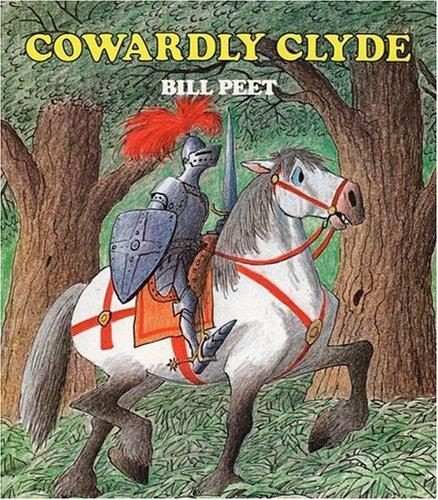

- **Author / illustrator:** Bill Peet
- **Publisher:** Houghton Mifflin
- **ISBN (paperback):** `978-0-395-36171-9`
- **About:** A war horse who is scared of everything, and still goes with his knight to face the ogre.
- **On our bookshelf:** home copy
- **Read:** Thursday, October 1, 2026 · Mitch

---

### 32. What Can It Be? Riddles About Baby Animals

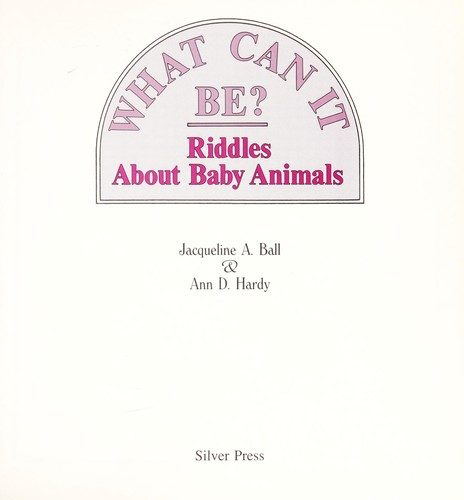

- **Series:** What Can It Be?
- **Publisher:** Silver Press
- **ISBN:** `978-0-671-68577-5` (`0-671-68577-5`)
- **About:** Photo riddles — hare, fawn, kid, kitten — turn the page for the answer and a science fact.
- **On our bookshelf:** home copy
- **Read:** Sunday, October 4, 2026 · Mitch

---

### 33. Sleep Is for Everyone

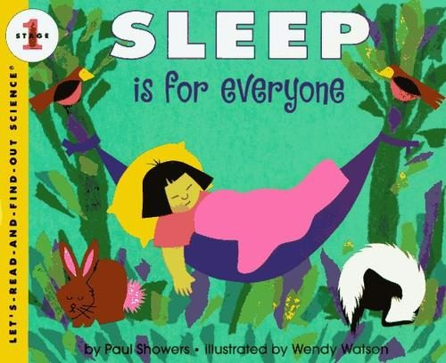

- **Author:** Paul Showers · **Illustrated by:** Wendy Watson
- **Series:** Let’s-Read-and-Find-Out Science, Stage 1
- **Publisher:** HarperTrophy
- **ISBN:** `978-0-06-445141-3`
- **About:** Why bodies need sleep, from babies to grown-ups.
- **On our bookshelf:** home copy
- **Read:** Sunday, October 4, 2026 · Mitch

---

### 34. Patrick: Patron Saint of Ireland

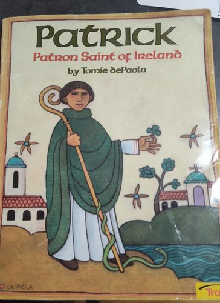

- **Author / illustrator:** Tomie dePaola
- **This copy:** Troll Special Edition (back cover has the sheep-on-a-checkerboard picture; *Cleary* written on it)
- **About:** Patrick’s life in Ireland, told in dePaola’s picture-book style — crozier, shamrock, and the snake.
- **On our bookshelf:** home copy
- **Read:** Wednesday, October 7, 2026 · Mitch

---

### 35. Sleepy Dog

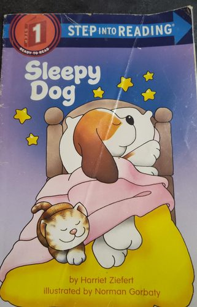

- **Author:** Harriet Ziefert · **Illustrated by:** Norman Gorbaty
- **Series:** Step into Reading, Step 1 (Ready to Read) · F&P level D
- **Publisher:** Random House
- **ISBN:** `978-0-394-86877-6`
- **About:** Sleepy Dog gets a good-night kiss and goes to bed.
- **On our bookshelf:** home copy
- **Read:** Wednesday, October 7, 2026 · Mitch

---

### 36. Papa’s Mechanical Fish

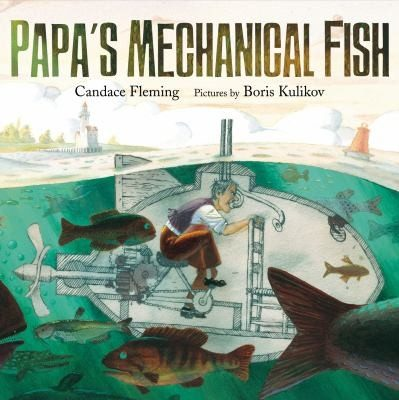

- **Author:** Candace Fleming · **Pictures by:** Boris Kulikov
- **Publisher:** Farrar, Straus & Giroux (2013)
- **ISBN:** `978-0-374-39908-5`
- **About:** Papa builds a submarine after Virena asks what it is like to be a fish. Based on inventor Lodner Phillips and his Lake Michigan boat.
- **On our bookshelf:** home copy
- **Read:** Sunday, October 11, 2026 · Mitch · again Monday, October 12, 2026

---

### 37. Llama Llama Holiday Drama

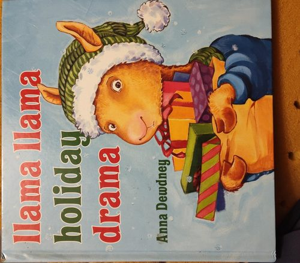

- **Author / illustrator:** Anna Dewdney
- **Publisher:** Viking
- **ISBN:** `978-0-670-01161-2`
- **About:** Llama Llama gets worked up waiting for the holidays, then remembers what the day is really for.
- **On our bookshelf:** home copy
- **Read:** Monday, October 12, 2026 · Mitch

---

### 38. Snowmen at Night

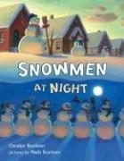

- **Author:** Caralyn Buehner · **Pictures by:** Mark Buehner
- **Publisher:** Dial Books (2002)
- **ISBN:** `978-0-8037-2550-8`
- **About:** What snowmen do after the kids go inside — skating, sledding, and a snowball game under the moon.
- **On our bookshelf:** home copy
- **Read:** Monday, October 12, 2026 · Mitch

---

### 39. The Snowy Day

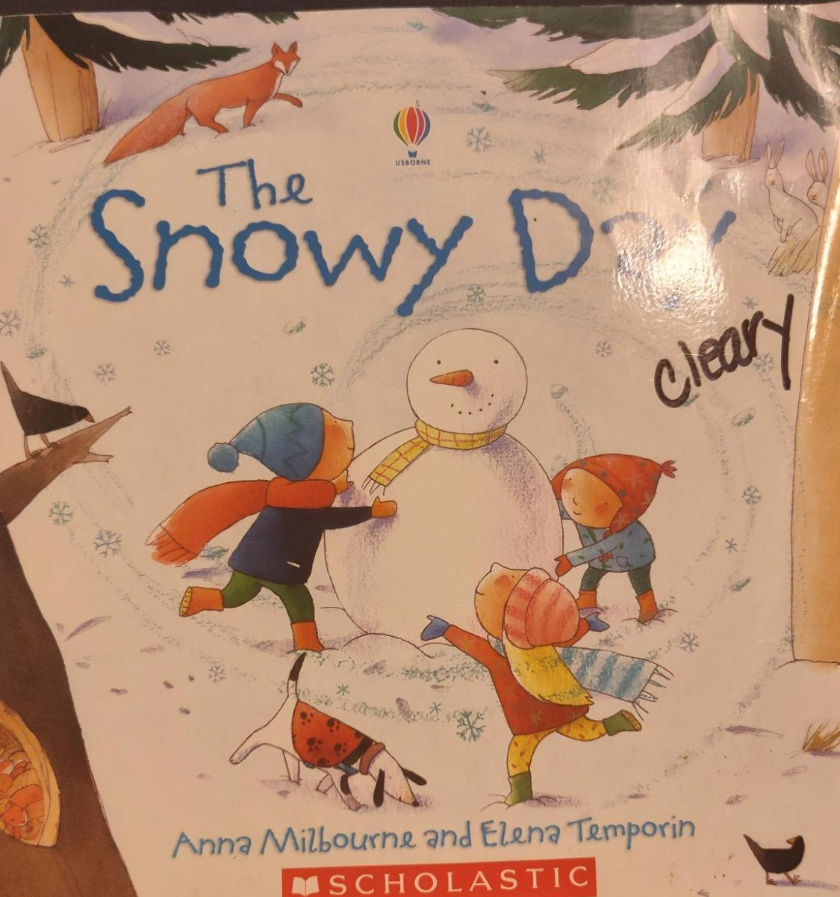

- **Author:** Anna Milbourne · **Illustrated by:** Elena Temporin
- **Publisher:** Usborne · this copy Scholastic
- **ISBN (Usborne):** `978-0-7460-6978-3`
- **About:** A snowy day with children, a snowman, a fox, and squirrels. Not the Ezra Jack Keats book.
- **This copy:** *Cleary* written on the cover
- **On our bookshelf:** home copy
- **Read:** Saturday, October 17, 2026 · Mitch

---

### 40. Inch by Inch: The Garden Song

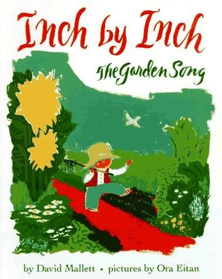

- **Author:** David Mallett · **Pictures by:** Ora Eitan
- **Publisher:** HarperTrophy
- **ISBN:** `978-0-06-443481-2`
- **About:** Picture-book version of the garden song — inch by inch, row by row.
- **On our bookshelf:** home copy
- **Read:** Saturday, October 17, 2026 · Mitch

---

### 41. Dear Zoo

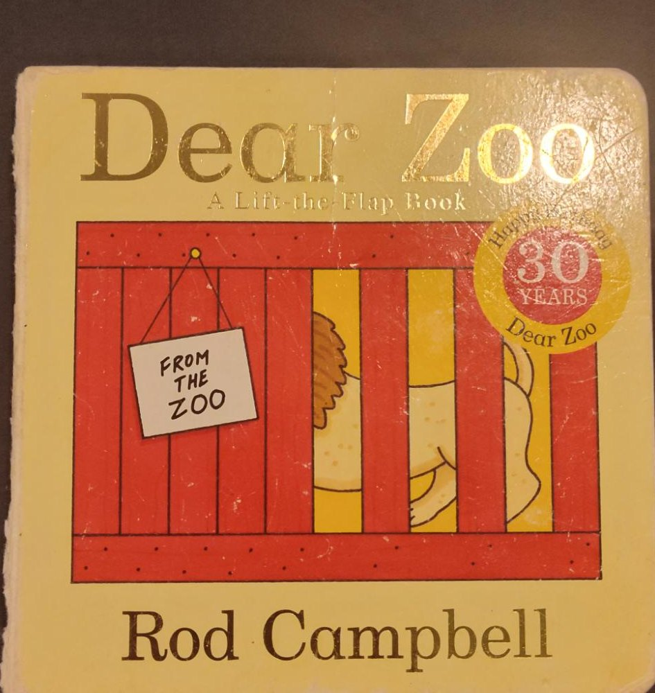

- **Author / illustrator:** Rod Campbell
- **Format:** Lift-the-flap · 30 years edition
- **ISBN (30th anniversary):** `978-0-7181-9267-9`
- **About:** A child writes to the zoo for a pet; the animals keep arriving until the right one does.
- **On our bookshelf:** home copy
- **Read:** Saturday, October 17, 2026 · Mitch

---

### 42. Splosh

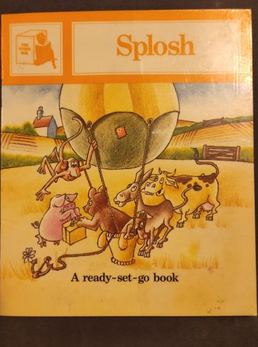

- **Series:** Ready-set-go / The Story Box
- **Authors:** Joy Cowley · June Melser · Phillip Webb
- **Publisher:** Shortland Publications
- **ISBN:** `978-0-86867-070-6`
- **About:** Farm animals and a hot-air balloon.
- **On our bookshelf:** home copy
- **Read:** Sunday, October 18, 2026 · Mitch

---

### 43. Oh, the Pets You Can Get!

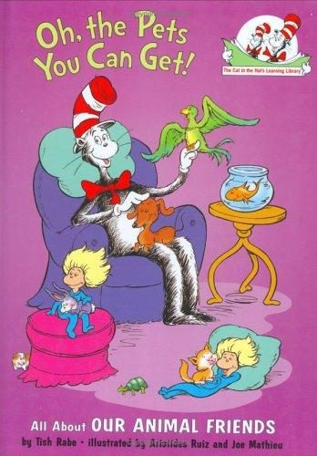

- **Series:** The Cat in the Hat’s Learning Library
- **Author:** Tish Rabe · **Illustrated by:** Aristides Ruiz and Joe Mathieu
- **Publisher:** Random House
- **ISBN:** `978-0-375-82278-0`
- **This copy:** “Available exclusively in the Indian Subcontinent”
- **About:** Pets and animal friends, told in Seuss-style rhyme.
- **On our bookshelf:** home copy
- **Read:** Sunday, October 18, 2026 · Mitch

---

### 44. Mitch to the Rescue

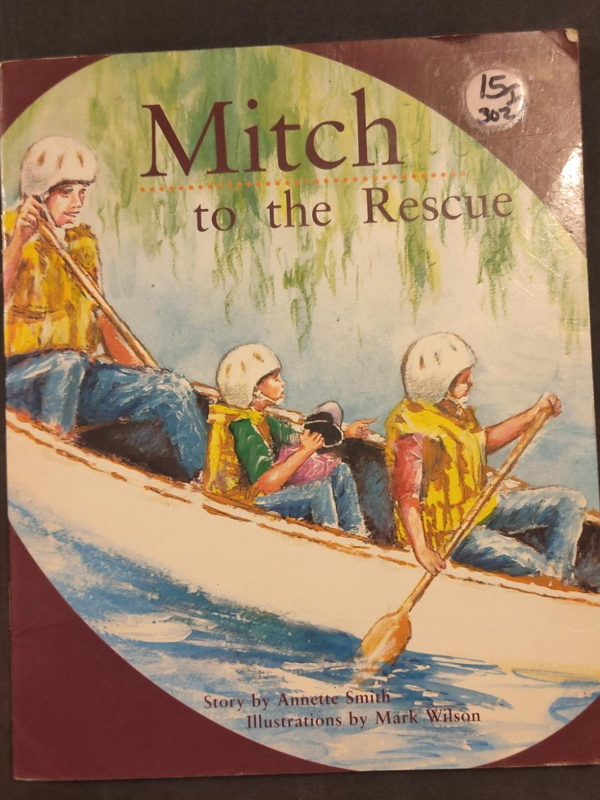

- **Story:** Annette Smith · **Illustrations by:** Mark Wilson
- **Publisher:** Nelson Price Milburn
- **ISBN:** `978-0-7635-1962-9`
- **About:** Mitch and his dad rescue a duckling from a canoe.
- **On our bookshelf:** home copy
- **Read:** Sunday, October 18, 2026 · Mitch

---

## Returned library loans

Not on the shelf anymore. Kept so the reading record stays complete.

### Chickens — returned

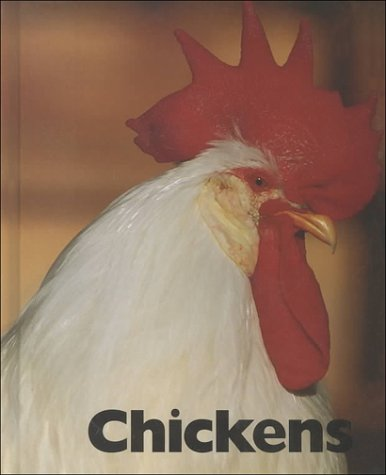

- **Author:** Mary Ann McDonald
- **Source:** **Mt. View Elementary School library (MVES)** · call number `636.5 MCD`
- **Favorite:** Saturday, August 29, 2026
- **Read:** Saturday, August 29, 2026 · Mitch
- **Status:** Returned to MVES · Thursday, October 1, 2026

---

## How to add a book

Copy a card above. Drop the cover JPEG in `covers/` and use:

```

```

Or send a photo and ask to add it.
